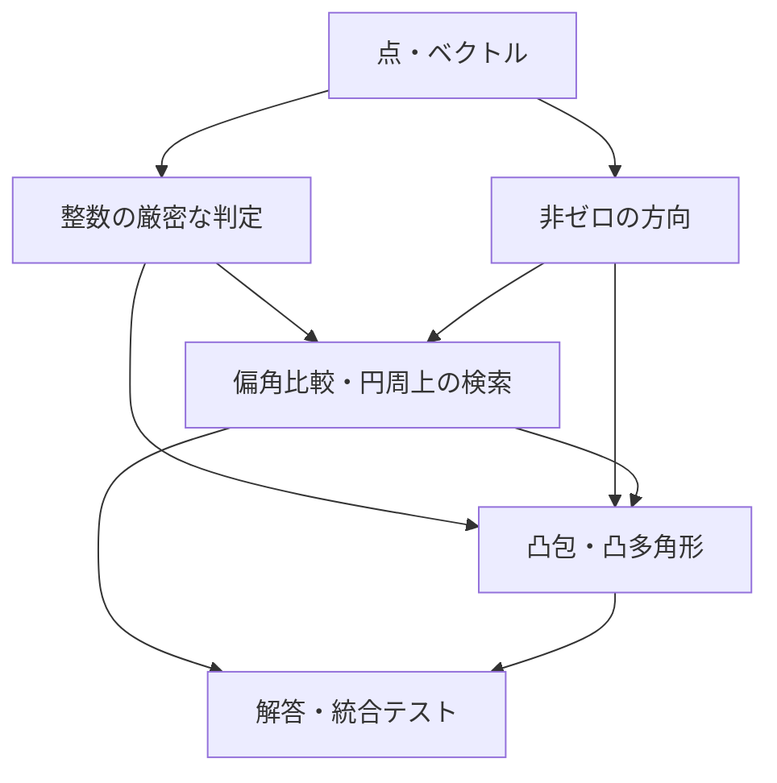

# 2026-10-25-integer-geometry: 整数二次元幾何と偏角・凸多角形の設計

関連 Issue: [#79](https://github.com/sakikuroe/algorithms-and-data-structures-rs/issues/79)

## 本設計の状態履歴

- In Review (2026-10-25): [PR #80](https://github.com/sakikuroe/algorithms-and-data-structures-rs/pull/80) の第1段階として設計を確認する。Issue の範囲は合意済み。本書の型、数値保証、公開インターフェースは未承認。

## 本設計の概要及び前提

`geometry` モジュールを新設し、整数座標の幾何で共通する表現と判定を、方向の整列・検索と凸多角形の処理から利用する。背景、今回追加する機能、対象問題、完了条件は Issue #79 を管理元とする。本書では、それらを実現する構成と、利用者が問題ごとの解答で受け持つ処理を定める。

既存のライブラリーには幾何の共通モジュールがない。一方、解答バイナリーの登録、統合テスト、単一ファイルへのバンドル、rustdoc の検証と公開は既存の仕組みを利用できる。今回の追加では、これらを新しい対象問題にも適用する。

整数座標の順序・位置関係は厳密に判定し、角度や距離を近似値として返す計算とは分ける。今回の幾何アルゴリズムは静的な点列を対象とする。将来の円や交点構成、動的凸包などは本書の依存関係に接続できるようにするが、未使用の汎用数値カーネルや拡張用 trait を先に実装する前提は置かない。

## 提案する構成及び処理の流れ

### データ表現と依存関係

`geometry::primitives` が `Point2<T>` と `Vector2<T>` を提供し、`geometry::predicates` が三点の向き、線分上判定、線分同士の関係を扱う。`geometry::direction` は長さを持たない非ゼロの方向を表し、`geometry::argument` は偏角比較と円周上の検索を提供する。`geometry::convex_polygon` は点群からの凸包構築と、正規化した凸多角形の問い合わせ・演算を受け持つ。積の符号比較などの数値処理は非公開の `geometry::kernel` に集約する。



点とベクトルは別の型とし、点同士の差はベクトル、点の平行移動は点、ベクトルの加減算はベクトルを返す。公開座標は `x`・`y` とし、添字や重みは幾何型に埋め込まない。必要な問題では元の配列と添字で対応づける。

```rust
pub struct Point2<T> {
    pub x: T,
    pub y: T,
}

pub struct Vector2<T> {
    pub x: T,
    pub y: T,
}
```

型の入れ物は座標型をパラメーターに取るが、今回の演算とアルゴリズムは `i64` 座標に対して実装する。これにより、将来 `Point2<f64>` を使う構成を検討する際にも、座標の保持形式を別物として作り直さずに済む。ただし、整数用の比較や正規化が実数にもそのまま使えるとは扱わない。

座標の等値と辞書順は座標によって決まる。偏角順は明示的な比較関数または方向型の順序であり、点・ベクトルの `Ord` として定義しない。ベクトル `(1, 1)` と `(2, 2)` は異なる値である一方、方向としては等しいという違いを保つ。

### 数値計算の保証

公開座標には `i64` を用いる。座標を返す加減算・整数倍・回転は、結果が `i64` に収まる場合に定義し、常に checked 演算で検査する。内積・外積の値は `i128`、長さ・距離の二乗と非負の面積の二倍は `u128` を候補とする。値を返す操作で返却型に収まらない場合は、debug・release ともにパニックする。オーバーフローを `None` と混同せず、`None` は方向が存在しない場合や問い合わせ結果がない場合に用いる。

判定に必要なものが符号や大小だけである場合には、これらの値取得メソッドを経由しない。三点の向きでは、`i64` 座標を `i128` に変換してから差を取る。差の絶対値は最大でも `u64::MAX` なので、二つの差の積の絶対値は `u128` に収まる。積を符号と絶対値に分け、二つの符号付き積を比較すれば、差そのものを `i128` に格納せずに外積の符号を求められる。

同様に、内積の大小や方向比較には、符号付き積の比較を用いる。二点間の距離の二乗の比較では、二つの `u128` の平方和を桁上がりと下位値の組で保持する。これらを非公開の部品とし、偏角比較、向き、線分の関係、支持点と最遠点の選択は `i64` の全座標域で正確に判定する案とする。通常の座標で利用できる `i128` の高速経路と、広い値に対する経路の検証は未決事項に記す。

この保証と、値の取得・座標の構成が可能な範囲は区別する。たとえば、内外判定ができる凸多角形でも面積の二倍が `u128` に収まるとは限らず、Minkowski 和の頂点の座標が `i64` に収まるとも限らない。各値の取得・構成時に検査し、それを必要としない判定まで失敗させない。凸多角形の構築時に面積の二倍を必須のキャッシュとして計算しないのは、このためである。

将来、有理数の交点や実数座標の円を構成する処理では、座標の表現と精度の規則を別途定める。整数の判定結果を先に得られる処理はそれを利用し、実数の近似的な等値をソート順やハッシュキーへ混ぜない。今回、新しい多倍長整数ライブラリーへの依存は追加しない。

### 方向と位置関係

`Direction` は正の整数倍を同じ値とする非ゼロの有向方向で、`Eq`・`Hash`・偏角順の `Ord` を持つ。正規化には既存の `math::number_theory::gcd` を利用する。内部の成分は非公開の `i128` とし、二点間の差を狭い座標型へ戻さずに正規化できるようにする。成分の絶対値の上限は `u64::MAX` とする。

```rust
impl Direction {
    pub fn from_vector(vector: Vector2<i64>) -> Option<Self>;
    pub fn between(from: Point2<i64>, to: Point2<i64>) -> Option<Self>;
    pub fn opposite(self) -> Self;
    pub fn rotate_quarter_turns(self, turns: i32) -> Self;
    pub fn unoriented(self) -> LineDirection;
    pub fn dot_sign(self, other: Self) -> cmp::Ordering;
    pub fn cross_sign(self, other: Self) -> cmp::Ordering;
    pub fn angle_to(self, other: Self) -> f64;
}
```

これらは設計を説明する主要な署名であり、実装済みの API 宣言ではない。`from_vector` はゼロベクトル、`between` は同一点に対して `None` を返す。それ以外の方向を構築できた後は、反転や 90 度単位の回転で方向が失われることはない。`opposite` は `i64::MIN` の直接の符号反転を呼び出し側に要求しない。

`LineDirection` は方向とその逆方向を同じ値とするキーであり、長さや直線の通る位置を含まない。同じ点を基準とした共線方向の集約に使えるが、平行な異なる直線を同じ直線として分類するキーとは区別する。将来、直線そのものの正規化を追加する場合は位置の情報も含む別の型で扱う。

`dot_sign` と `cross_sign` は内積と外積の符号を `Less`・`Equal`・`Greater` で返す。値そのものが固定幅整数に収まることを要求せず、非ゼロ方向同士の鋭角・直角・鈍角や、左右・同一直線上の分類に使える。`angle_to` は小さい方の角度をラジアンで返し、結果の範囲は `[0, π]` とする。角度の数値化は最終的な出力や近似計算に限定する。

```rust
pub enum Orientation {
    Clockwise,
    Collinear,
    CounterClockwise,
}

pub enum Location {
    Outside,
    Boundary,
    Inside,
}

pub enum SegmentRelation {
    Disjoint,
    Touching,
    Crossing,
    Overlapping,
}

pub fn orientation(a: Point2<i64>, b: Point2<i64>, c: Point2<i64>) -> Orientation;
pub fn on_segment(point: Point2<i64>, a: Point2<i64>, b: Point2<i64>) -> bool;
pub fn segment_relation(
    a: Point2<i64>, b: Point2<i64>, c: Point2<i64>, d: Point2<i64>,
) -> SegmentRelation;
```

`Crossing` は二つの非退化な線分の内部同士が一点で交わる場合、`Touching` はそれ以外の一点での接触、`Overlapping` は正の長さを持つ共通部分がある場合とする。長さゼロの線分も受け付け、点として線分上にある場合や同一点同士は `Touching` とする。交点の座標の構成は、この判定 API の責務には含めない。

### 偏角順と円周上の検索

絶対的な偏角順は `(-π, π]` の反時計回り順とする。原点を含むベクトル列のための `argument_cmp` では、原点を角度 0、すなわち正の x 軸方向と同じ比較位置に置く。これは整列のための規約であり、原点から幾何学的な方向を構築することとは区別する。同方向のベクトルは比較上等しいものとし、距離によるタイブレークは加えない。

```rust
pub fn argument_cmp(a: &Vector2<i64>, b: &Vector2<i64>) -> cmp::Ordering;
pub fn cmp_ccw_from(start: Direction, a: Direction, b: Direction) -> cmp::Ordering;

impl PolarOrder {
    pub fn new(directions: impl IntoIterator<Item = Option<Direction>>) -> Self;
    pub fn indices(&self) -> &[usize];
    pub fn zero_indices(&self) -> &[usize];
    pub fn direction_at(&self, position: usize) -> Option<Direction>;
    pub fn lower_bound(&self, direction: Direction) -> usize;
    pub fn upper_bound(&self, direction: Direction) -> usize;
    pub fn ccw_range(&self, range: impl ops::RangeBounds<Direction>) -> CyclicRange;
}

impl CyclicRange {
    pub fn len(&self) -> usize;
    pub fn is_empty(&self) -> bool;
    pub fn split(&self) -> [ops::Range<usize>; 2];
    pub fn complement(&self) -> Self;
}
```

署名中の `cmp`・`ops` は、それぞれ `std::cmp`・`std::ops` を表す。`argument_cmp` は半平面の分類と積の符号比較だけを使い、比較のたびに方向の GCD 正規化を行わない。任意の始線からの順序には `cmp_ccw_from` を使い、時計回りの比較は引数の順を入れ替える。始線と同方向の値を先頭とし、一周後の同方向を別の値として比較することはしない。

`PolarOrder` は入力順の添字を採番し、方向がある要素を整列して保持する。`None` はゼロベクトルまたは基準点と同一点であることを表し、その添字は `zero_indices` で別に保持する。`indices` と `direction_at` は非ゼロ方向の整列位置を対象とする。両方の添字列を合わせると元の入力の各添字が一度ずつ現れ、同方向・同座標であっても入力要素を統合しない。同方向内の順は元の添字順に固定する。

この構成では、点列をある点の周囲で整列するときは `Direction::between` の結果を、ベクトル列では `Direction::from_vector` の結果を順に渡せる。座標差が `i64` に収まらない場合にも、方向を求めるためだけに狭いベクトルを作る必要はない。幾何的に方向がない点を、半平面の数え上げへ暗黙に混ぜないことも保証する。

`lower_bound` と `upper_bound` は非ゼロ方向列に対する挿入位置で、範囲は `0..=len` とする。`ccw_range` は、指定した始方向から終方向までを反時計回りに進む一周未満の範囲を返す。異なる両端が絶対偏角の切れ目をまたぐ場合も受け付ける。片端だけが省略された範囲は絶対偏角順の先頭または末尾までとし、`..` は非ゼロ方向の全体とする。

両端が同じ方向の場合、`d..=d` だけがその方向の全要素を含み、それ以外の端点指定は空とする。一周全体は `..` で明示し、ある方向以外の一周は `d..=d` の結果の補集合で表せる。これにより、同じ両端を空区間と一周の両方に解釈する必要がなくなる。

`CyclicRange` は角度区間そのものではなく、固定された整列列に属する要素の範囲である。空か全体かを明示する状態と、列の長さ・開始位置・要素数を保持し、結果は常に高々一周分とする。`split` は走査順の二つの通常の添字範囲を返し、不要な側は空範囲にする。利用者は `indices` を並べた順の累積和や既存のセグメント木にこれらの範囲を渡せる。`complement` は同じ列に対する補集合を返し、空と全体も正しく反転する。

整列は方向の構築を除いて O(n log n)、領域は O(n) とする。GCD 正規化は入力方向ごとに一度だけ行う。固定幅整数での方向構築を含めた時間は O(n log n + n log C) で、C は座標差の絶対値の上限である。挿入位置と角度区間の検索は O(log n)、`CyclicRange` の個数取得・分割・補集合は O(1) とする。列挙するときだけ、結果の要素数に比例した時間を使う。

### 凸包と凸多角形

点群からの凸包は、元の点列の添字を返す関数と、問い合わせ用の `ConvexPolygon` の構築を分ける。前者は ID を必要とする問題に、後者は繰り返す問い合わせと多角形間の演算に使う。

```rust
pub enum CollinearPoints {
    EndpointsOnly,
    AllBoundary,
}

pub fn convex_hull_indices(
    points: &[Point2<i64>], collinear: CollinearPoints,
) -> Vec<usize>;
pub fn furthest_pair(points: &[Point2<i64>]) -> Option<(usize, usize)>;

impl ConvexPolygon {
    pub fn from_points(points: &[Point2<i64>]) -> Self;
    pub fn try_from_boundary(vertices: &[Point2<i64>]) -> Result<Self, NonConvexError>;
    pub fn vertices(&self) -> &[Point2<i64>];
    pub fn locate(&self, point: Point2<i64>) -> Location;
    pub fn support(&self, direction: Direction) -> Option<SupportFace>;
    pub fn diameter(&self) -> Option<(usize, usize)>;
    pub fn area2(&self) -> u128;
    pub fn minkowski_sum(&self, other: &Self) -> Self;
}

pub enum SupportFace {
    Vertex(usize),
    Edge { start: usize, end: usize },
}
```

`convex_hull_indices` は Andrew の走査で構築し、座標による辞書順で最小の頂点から反時計回りに返す。同一座標が複数ある場合は最小の元添字を代表とし、閉じるための先頭頂点の再掲は行わない。`EndpointsOnly` は辺の途中の共線点を除き、`AllBoundary` は異なる座標の境界点を残す。全点が共線の場合、前者は両端だけ、後者は座標の辞書順で一度ずつ返す。

`ConvexPolygon` の内部では、空集合、一点、線分、狭義凸多角形のいずれかへ正規化する。三頂点以上では反時計回り、辞書順最小の頂点を先頭とし、隣接重複と辺の途中の共線点を持たない。元添字は多角形の不変条件に含めず、必要な利用者は凸包の添字列を別に保持する。Minkowski 和で生成された頂点にも同じ表現を用いる。

`from_points` は点群から凸包を構築するので O(n log n) とする。`try_from_boundary` は既に凸な境界順で与えられた頂点列を受け取り、時計回り・末尾の先頭頂点の再掲・隣接重複・辺上の共線点を正規化する。非凸または自己交差する入力は拒否する。線形時間で検査する案は未決事項で扱い、局所的な三点の向きだけで単純な凸多角形と判断しない。

`locate` は三頂点以上では頂点を起点とした扇形の二分探索と向きの判定を用い、O(log n) とする。空集合では `Outside`、一点や線分上では `Boundary` とし、退化した図形に `Inside` は存在しない。辺と頂点の境界判定を同じ規則で扱う。

`support` は、指定方向との内積が最大になる面を O(log n) で取得する。最大が一頂点なら `Vertex`、一辺全体なら反時計回りの両端を `Edge` として返す。最小側は逆方向の支持面で得る。空集合は `None`、一点はその頂点、線分で両端が同値になる場合は線分全体を返す。この結果により、将来の接線や直線との交差検索でも、同値な端点を探し直さずに済む。

`diameter` は回転キャリパーで O(n) とし、正規化後の頂点添字を返す。空集合は `None`、一点は `(0, 0)`、線分は両端とする。これに対し `furthest_pair` は入力の異なる二添字を返し、入力点が二個未満なら `None` とする。同一座標の入力しかない場合も、二個以上あれば異なる元添字を返す。この違いを公開例で示し、凸包の重複除去によって元の点の個数を失わない。

`area2` は向きを正規化した非負の面積の二倍を返し、点・線分・空集合では 0 とする。O(n) の三角形分割による和を取得時に計算し、各寄与と累積を検査する。問い合わせのための必須の前計算にはしない。

`minkowski_sum` は、二つの多角形の辺を同じ始線からの偏角順に併合し、同方向の辺を同時に進める。始点を内部で選び直し、結果を共通の表現へ O(n + m) で正規化する。構築済みの多角形をいったん点群へ戻して凸包を計算し直す方法は用いない。空集合との和は空集合、一点との和は平行移動とし、線分同士や平行な辺を持つ場合も扱う。生成する頂点の座標は checked 演算で検査する。

### 解答側での組み合わせと将来の拡張

半平面の数え上げでは、非ゼロの開始方向 `d` に対する `d..d.opposite()` の検索で、開始方向を含み反対方向を含まない半周を取得できる。境界を両方除く場合は `Bound` を指定する。元添字から重みを並べた累積和を使えば、同じ範囲を個数だけでなく重みの合計にも利用できる。ただし、偏角順のすべての連続区間の最適化と、最大限広い半周だけを調べることは同一とは扱わず、必要な区間の選択は解法に合わせる。

典型90 009 では、各基準点からの方向列を作り、各方向の逆方向の挿入位置と前後の候補を調べ、`angle_to` で出力値を求める。ABC033 D では整数の内積・外積による分類を使い、実数の角度との等値比較は行わない。ABC225 E では方向の区間端点を比較して区間を選び、ABC248 E では `LineDirection` を同じ基準点からの共線方向のキーとして使う。

ABC139 F のようなベクトル和の最適化は、方向順の添字と元のベクトルの累積和を接続して記述する。ABC296 G では凸な境界の構築と `locate` を利用する。Library Checker の整列は原点を含む `argument_cmp`、凸包は元添字を返す関数、最遠点対は異なる元添字を返す関数で検証する。問題別の最大化や数え上げを汎用モジュールの引数へ押し込めない。

今後の半平面共通部分や切断では方向順と支持面、Minkowski 和からの図形間の演算では正規化した凸多角形、面列挙や arrangement では頂点周囲の方向順と線分の関係を再利用できる。円や有理数の交点では `Point2` の保持形式と整数で判定できる部分を利用し、座標の構成と精度管理を別の処理へ置く。Manhattan MST や長方形和集合は必要な座標変換や既存のグラフ・データ構造と組み合わせる独立したアルゴリズムとする。

## 検討した代替案及び採用理由

既存の `ComplexNumber<T>` に幾何の機能を集める方式は、加減算と複素数の積を使う問題には便利である。しかし、点の移動、方向の同一性、実数の近似計算を一つの型の規則で扱うと、何を比較しているかが曖昧になる。今回は点とベクトルを分け、非ゼロ方向には専用の型を使う。型を覚える負担は増えるが、方向の等値・ハッシュ・順序を一致させ、ゼロを受け付ける箇所も構築時に限定できる。

タプルに対する比較関数だけを追加すれば最初の整列は短く書ける。一方、二周の添字、同方向の集約、区間端点、元の要素との対応は各解答に残る。このため、通常の `sort_by` で使う比較関数を残しつつ、検索を繰り返す用途に `PolarOrder` と `CyclicRange` を設ける。位置の取得、個数、分割を共通の結果から得られるようにし、問題ごとの数え上げ関数を多数追加する構成は採らない。

数値計算をすべて `i128` に変換する案は通常の座標では簡潔だが、座標差同士の積や和が `i128` の範囲を超える場合がある。全演算を多倍長整数で行う案では、今回の比較のために新しい依存や大きい定数時間を持ち込む。今回は符号・大小だけを扱う厳密な判定と、固定幅で値を返す演算を分ける。その分、非公開の数値処理の検証が必要になる。

実数の角度をソートキーにする案は角度区間を直観的に扱えるが、近い方向の順序を正確に決められない場合がある。整数の比較順に一本化し、角度の実数値が必要になった時点で変換する。また、整数・有理数・実数を一つの汎用 trait 群ですべて扱う構成は、今回の要求を満たすうえで不要な前提を増やすため採用しない。

代替案との比較と判断理由は本書で扱い、この設計段階では別の ADR は作成しない。将来、既存の数値保証や表現を変える必要が出た場合は、その変更の範囲に応じて判断の記録先を検討する。

## 本設計による影響及び移行方針

新しい `geometry` と解答・テスト用のターゲットを追加する。既存のデータ構造やグラフの公開 API、既存の解答の形式は変更しない。`src/lib.rs` には幾何モジュールの要約を追加し、詳細な使い方、入力条件、戻り値、計算量、パニック条件は実装の文書用コメントを編集元として rustdoc へ生成する。

Design Doc は `docs/design/` に配置し、本書は実装前の方式を共有する設計記録として保管する。実装時に方式が変われば本文を更新し、公開仕様は文書用コメントへ反映する。独立した API リファレンスや変更履歴のファイルへ同じ仕様を重ねて転記しない。

PR #80 で設計確認と実装確認を二段階に分けて行う。第1段階では Design Doc をレビューし、設計への合意後に状態履歴へ Approved を追記する。第2段階では同じブランチ・同じ PR に実装、テスト、文書用コメントを追加し、実装を含む全体を確認してからマージする。

実装では、数値判定と点・方向を先に確認し、その上に偏角順、円周上の検索、凸多角形を接続する。上位機能の検証で必要な操作が欠けた場合は、基盤の API へ戻って設計を見直す。設計全体の実装が揃ってから状態履歴に Implemented を追記する。設計への合意だけで実装済みや検証済みとは扱わない。

## 本設計の検証方針

数値判定は符号だけの結果と、値の取得で表現できる範囲を別々に確認する。`i64::MIN`・`i64::MAX`、その近傍、同一点、ゼロ成分、積の差が小さくなる方向を含める。多倍長整数を使う外部の参照計算から期待値を作成し、Rust の判定結果と照合する。参照計算は検証用とし、ライブラリーの実行時依存にはしない。checked 演算の範囲外が release でも検出されることも確認する。

偏角比較では軸上の方向、原点、正の整数倍、逆方向、ほとんど同方向のベクトルについて、反対称性・推移性・同値類の整合性を検証する。整列結果は入力との対応を失わず、同偏角の任意の順序を認める問題では、一つの固定した出力文字列だけに依存せず正しさを判定する。

円周上の検索は、小さい全方向列に対して各要素の所属を直接判定する素朴解と比較する。重複方向、方向が一つもない列、ゼロだけの入力、両端が同方向、全体と空、切れ目をまたぐ区間、すべての端点指定を含める。`split` の範囲の連結、個数、補集合、元添字の保存が同時に一致することを確認し、個数と重みの集約の双方に接続する。

凸包は小さな点群を独立した gift wrapping の参照実装とも比較し、凸性、全入力の包含、代表となる元添字と境界点の方針を確認する。境界からの構築では時計回り、共線点、重複、往復する辺、自己交差する星形の頂点列を含める。局所的な向きだけが揃う自己交差を誤受理しないことを重点的に確認する。

支持面は全頂点の走査、内外判定は全辺による判定、直径と最遠点対は全点対、Minkowski 和は頂点の全組合せの和から作る凸包と照合する。空・一点・線分・全点重複に加え、平行な辺、支持面が辺になる方向、同じ距離の候補が複数ある場合を含める。

対象問題と完了条件は Issue #79 に従う。既存の統合テスト構成に解答を登録し、公式サンプル、境界例、小規模な素朴解との比較を実行する。API の文書用コメントにも、元添字や重みと接続する使用例を含める。単体・統合・ドキュメントテスト、fmt、Clippy、型チェック、警告をエラー扱いにした文書生成、提出用バンドルの単独コンパイルで確認する。実行結果は同じ PR #80 の実装段階で記録し、本書の検証方針を結果の記録として重ねて更新しない。

## 未決事項

三点の向きや距離の比較における、固定幅の高速経路と広い値を扱う経路の実装は未検証である。API の数値保証を変える要因なので、基盤の実装前に積と和の上限を確認し、任意精度の参照計算と境界値・ランダム入力で照合する。通常の比較が遅くなる場合にも正確さを落とすのではなく、経路の分岐と非公開の表現を調整する。

`try_from_boundary` の O(n) の検査では、同方向の辺の整理、局所的な向き、辺方向の一周性を組み合わせる案を検討する。自己交差と退化の扱いに影響するため、小さい点集合の頂点順列も使って凸包との一致を照合する。線形検査の正しさを確認できない場合は、凸包との O(n log n) の照合へ変更する。Minkowski 和は内部で正規化した結果を直接構築するため、外部入力用の検査へ戻らず O(n + m) を維持する。

`PolarOrder` に `Option<Direction>` の列を渡す構成は、ゼロを失わず元添字を保持するための案である。基準点を変える点群、単純なベクトル列、ID・重みを持つ列の使用例を比較し、毎回同じ変換が必要なら入力用のコンストラクターを追加するかを設計レビューで判断する。その場合も、ゼロ方向の規則と整列・検索の実装は一か所に保つ。

## 関連する Issue・PR・ドキュメント

- [Issue #79](https://github.com/sakikuroe/algorithms-and-data-structures-rs/issues/79): 要求、今回の対象と後続の対象、統合テストに追加する問題、完了条件の管理元。
- [Library Checker の Sort Points by Argument](https://github.com/yosupo06/library-checker-problems/blob/master/geo/sort_points_by_argument/task.md): 原点を角度 0 とする整列順と、近い方向を整数で比較する必要性の確認先。
- [maspy さんの凸多角形の実装](https://maspypy.github.io/library/geo/convex_polygon.hpp): 支持面、内外判定などを共通の頂点列で扱う構成と、狭義凸・退化した場合の前提を検討する参照先。
- [Minkowski 和の解説](https://cp-algorithms.com/geometry/minkowski.html): 辺の偏角順の併合と、図形間の距離・交差判定への接続の参照先。
- [CGAL の幾何カーネルの説明](https://doc.cgal.org/latest/Kernel_23/index.html): 幾何データ、厳密な判定、座標の構成、上位アルゴリズムを分ける考え方の参照先。今回のライブラリーへの依存追加を意味しない。
