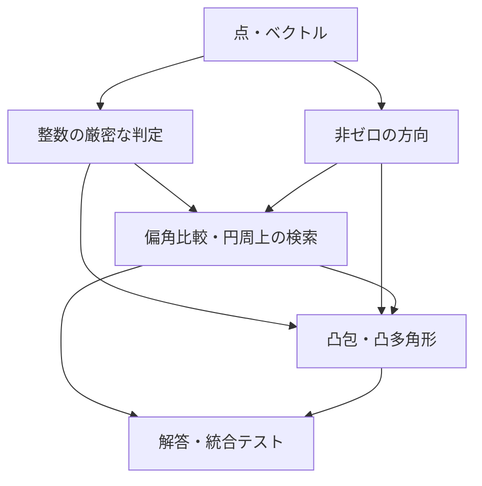

# 2026-10-25-integer-geometry: 整数二次元幾何と偏角・凸多角形の設計

関連 Issue: [#79](https://github.com/sakikuroe/algorithms-and-data-structures-rs/issues/79)

## 本設計の状態履歴

- In Review (2026-10-25): [PR #80](https://github.com/sakikuroe/algorithms-and-data-structures-rs/pull/80) の第1段階として設計を確認する。Issue の範囲は合意済み。本書の型、数値保証、公開インターフェースは未承認。

## 本設計の概要及び前提

`geometry` モジュールを新設し、整数座標の幾何で共通する表現と判定を、方向の整列・検索と凸多角形の処理から利用する。背景、今回追加する機能、対象問題、完了条件は Issue #79 を管理元とする。本書では、それらを実現する構成と、利用者が問題ごとの解答で受け持つ処理を定める。

既存のライブラリーには幾何の共通モジュールがない。一方、解答バイナリーの登録、統合テスト、単一ファイルへのバンドル、rustdoc の検証と公開は既存の仕組みを利用できる。今回の追加では、これらを新しい対象問題にも適用する。

整数座標の順序・位置関係は厳密に判定し、角度や距離を近似値として返す計算とは分ける。今回の幾何アルゴリズムは静的な点列を対象とする。将来の円や交点構成、動的凸包などは本書の依存関係に接続できるようにするが、未使用の汎用数値カーネルや拡張用 trait を先に実装する前提は置かない。

## 提案する構成及び処理の流れ

### データ表現と依存関係

`geometry::primitives` が `Point2<T>` と `Vector2<T>` を提供し、`geometry::predicates` が三点の向き、線分上判定、線分同士の関係を扱う。`geometry::direction` は長さを持たない非ゼロの方向を表し、`geometry::argument` は偏角比較と円周上の検索を提供する。`geometry::convex_polygon` は点群からの凸包構築と、正規化した凸多角形の問い合わせ・演算を受け持つ。積の符号比較などの数値処理は非公開の `geometry::kernel` に集約する。



点とベクトルは別の型とし、点同士の差はベクトル、点の平行移動は点、ベクトルの加減算はベクトルを返す。公開座標は `x`・`y` とし、添字や重みは幾何型に埋め込まない。必要な問題では元の配列と添字で対応づける。

```rust
pub struct Point2<T> {
    pub x: T,
    pub y: T,
}

pub struct Vector2<T> {
    pub x: T,
    pub y: T,
}

impl Point2<i64> {
    pub fn distance_squared(self, other: Self) -> u128;
}

impl Vector2<i64> {
    pub fn dot(self, other: Self) -> i128;
    pub fn cross(self, other: Self) -> i128;
    pub fn dot_sign(self, other: Self) -> cmp::Ordering;
    pub fn cross_sign(self, other: Self) -> cmp::Ordering;
    pub fn norm_squared(self) -> u128;
    pub fn rotate_quarter_turns(self, turns: i32) -> Self;
}
```

型の入れ物は座標型をパラメーターに取るが、今回の演算とアルゴリズムは `i64` 座標に対して提供する。`Point2<T>` と `Vector2<T>` は、座標型が満たす範囲で `Clone`・`Copy`・`Debug`・`PartialEq`・`Eq`・`Hash` を持つ。構築には公開フィールドを使い、同じ役割のコンストラクターや座標アクセサーを重ねない。将来の実数・有理数の保持形式には同じ型を利用できるが、それらの型に対する演算は今回の公開契約に含めない。

演算子は値を受け取る以下の組に限定する。署名中の `ops` は `std::ops`、`cmp` は `std::cmp` を表す。各 `Output` は演算の結果型である。

```rust
impl ops::Add<Vector2<i64>> for Point2<i64> {
    type Output = Point2<i64>;
    fn add(self, rhs: Vector2<i64>) -> Self::Output;
}
impl ops::Sub<Vector2<i64>> for Point2<i64> {
    type Output = Point2<i64>;
    fn sub(self, rhs: Vector2<i64>) -> Self::Output;
}
impl ops::Sub for Point2<i64> {
    type Output = Vector2<i64>;
    fn sub(self, rhs: Self) -> Self::Output;
}
impl ops::AddAssign<Vector2<i64>> for Point2<i64> {
    fn add_assign(&mut self, rhs: Vector2<i64>);
}
impl ops::SubAssign<Vector2<i64>> for Point2<i64> {
    fn sub_assign(&mut self, rhs: Vector2<i64>);
}
impl ops::Add for Vector2<i64> {
    type Output = Self;
    fn add(self, rhs: Self) -> Self::Output;
}
impl ops::Sub for Vector2<i64> {
    type Output = Self;
    fn sub(self, rhs: Self) -> Self::Output;
}
impl ops::Neg for Vector2<i64> {
    type Output = Self;
    fn neg(self) -> Self::Output;
}
impl ops::Mul<i64> for Vector2<i64> {
    type Output = Self;
    fn mul(self, rhs: i64) -> Self::Output;
}
impl ops::AddAssign for Vector2<i64> {
    fn add_assign(&mut self, rhs: Self);
}
impl ops::SubAssign for Vector2<i64> {
    fn sub_assign(&mut self, rhs: Self);
}
impl ops::MulAssign<i64> for Vector2<i64> {
    fn mul_assign(&mut self, rhs: i64);
}
```

点同士の和や点のスカラー倍は定義しない。点の平行移動とベクトルの演算を区別し、参照を受け取る演算子の組合せは増やさない。`i64` 座標の値は `Copy` なので、配列からの取得や参照の解除により値を渡せる。

座標の等値とハッシュは座標によって決まる。辞書順が必要な場合は `(x, y)` をキーにし、点・ベクトルに `Ord`・`PartialOrd` を付けない。偏角順には明示的な比較関数または方向型の順序を使う。ベクトル `(1, 1)` と `(2, 2)` は異なる値である一方、方向としては等しいという違いを保つ。

`dot` は `x1 * x2 + y1 * y2`、`cross` は `x1 * y2 - y1 * x2` の値を返し、`dot_sign`・`cross_sign` はゼロベクトルも受け付けて符号だけを返す。方向が存在しないベクトルにも符号の判定は定義できるので、符号の取得のために `Direction` の構築と `Option` の解除を要求しない。`norm_squared` は長さの二乗、`distance_squared` は二点間の距離の二乗とする。後者は広い座標差を内部で扱い、先に `Point2 - Point2` を計算することを要求しない。距離や長さを実数で出力するときは、取得した二乗値を変換して平方根を取る。

ベクトルと方向の `rotate_quarter_turns` はともに反時計回りを正とし、負の回転数と `i32` の全範囲を受け付け、4 を法として解釈する。整数の回転だけを今回の対象とし、実数の回転や単位ベクトルへの正規化は追加しない。

### 数値計算の保証

公開座標には `i64` を用いる。座標を返す加減算・整数倍・回転は、結果が `i64` に収まる場合に定義し、常に checked 演算で検査する。内積・外積の値は `i128`、長さ・距離の二乗と非負の面積の二倍は `u128` とする。値を返す操作で返却型に収まらない場合は、debug・release ともにパニックする。オーバーフローを `None` と混同せず、`None` は方向が存在しない場合や問い合わせ結果がない場合に用いる。

判定に必要なものが符号や大小だけである場合には、これらの値取得メソッドを経由しない。三点の向きでは、`i64` 座標を `i128` に変換してから差を取る。差の絶対値は最大でも `u64::MAX` なので、二つの差の積の絶対値は `u128` に収まる。積を符号と絶対値に分け、二つの符号付き積を比較すれば、差そのものを `i128` に格納せずに外積の符号を求められる。

同様に、内積の大小や方向比較には、符号付き積の比較を用いる。二点間の距離の二乗の比較では、二つの `u128` の平方和を桁上がりと下位値の組で保持する。これらを非公開の部品とし、偏角比較、向き、線分の関係、支持点と最遠点の選択は `i64` の全座標域で正確に判定する。高速な経路の有無で公開される結果や入力範囲は変えない。

この保証と、値の取得・座標の構成が可能な範囲は区別する。たとえば、内外判定ができる凸多角形でも面積の二倍が `u128` に収まるとは限らず、Minkowski 和の頂点の座標が `i64` に収まるとも限らない。各値の取得・構成時に検査し、それを必要としない判定まで失敗させない。凸多角形の構築時に面積の二倍を必須のキャッシュとして計算しないのは、このためである。

将来、有理数の交点や実数座標の円を構成する処理では、座標の表現と精度の規則を別途定める。整数の判定結果を先に得られる処理はそれを利用し、実数の近似的な等値をソート順やハッシュキーへ混ぜない。今回、新しい多倍長整数ライブラリーへの依存は追加しない。

### 方向と位置関係

`Direction` は正の整数倍を同じ値とする非ゼロの有向方向で、`Clone`・`Copy`・`Debug`・`PartialEq`・`Eq`・`Hash`・`PartialOrd`・偏角順の `Ord` を持つ。正規化には既存の `math::number_theory::gcd` を利用する。内部の成分は非公開の `i128` とし、二点間の差を狭い座標型へ戻さずに正規化できるようにする。成分の絶対値の上限は `u64::MAX` とする。

```rust
impl Direction {
    pub fn from_vector(vector: Vector2<i64>) -> Option<Self>;
    pub fn between(from: Point2<i64>, to: Point2<i64>) -> Option<Self>;
    pub fn opposite(self) -> Self;
    pub fn rotate_quarter_turns(self, turns: i32) -> Self;
    pub fn unoriented(self) -> LineDirection;
    pub fn dot_sign(self, other: Self) -> cmp::Ordering;
    pub fn cross_sign(self, other: Self) -> cmp::Ordering;
    pub fn angle_to(self, other: Self) -> f64;
}
```

これらは設計を説明する主要な署名であり、実装済みの API 宣言ではない。`from_vector` はゼロベクトル、`between` は同一点に対して `None` を返す。それ以外の方向を構築できた後は、反転や 90 度単位の回転で方向が失われることはない。`opposite` は `i64::MIN` の直接の符号反転を呼び出し側に要求しない。

`LineDirection` は `Clone`・`Copy`・`Debug`・`PartialEq`・`Eq`・`Hash` を持ち、方向とその逆方向を同じ値とするキーであり、長さや直線の通る位置を含まない。同じ点を基準とした共線方向の集約に使えるが、平行な異なる直線を同じ直線として分類するキーとは区別する。将来、直線そのものの正規化を追加する場合は位置の情報も含む別の型で扱う。

`dot_sign` と `cross_sign` は内積と外積の符号を `Less`・`Equal`・`Greater` で返す。値そのものが固定幅整数に収まることを要求せず、非ゼロ方向同士の鋭角・直角・鈍角や、左右・同一直線上の分類に使える。方向の二つのコンストラクターは O(log C)、ほかの方向操作と点・ベクトルの各基本演算・位置関係の判定は O(1) とする。`angle_to` は小さい方の角度の有限な近似値をラジアンで返し、結果の範囲は `[0, π]` とする。同方向は `0.0`、逆方向は `f64::consts::PI` とする。角度の数値化は最終的な出力や近似計算に限定する。

```rust
pub enum Orientation {
    Clockwise,
    Collinear,
    CounterClockwise,
}

pub enum Location {
    Outside,
    Boundary,
    Inside,
}

pub enum SegmentRelation {
    Disjoint,
    Touching,
    Crossing,
    Overlapping,
}

pub fn orientation(a: Point2<i64>, b: Point2<i64>, c: Point2<i64>) -> Orientation;
pub fn on_segment(point: Point2<i64>, a: Point2<i64>, b: Point2<i64>) -> bool;
pub fn segment_relation(
    a: Point2<i64>, b: Point2<i64>, c: Point2<i64>, d: Point2<i64>,
) -> SegmentRelation;
```

判定結果の列挙型と `CollinearPoints`・`SupportFace` は `Clone`・`Copy`・`Debug`・`PartialEq`・`Eq` を提供する。構築エラーの `NonConvexError` も `Debug` とエラー表示を提供し、`Result` として利用できるようにする。

`orientation(a, b, c)` は `a` から `b`、`a` から `c` への順の外積の符号を分類し、同一点を含む場合も `Collinear` とする。`on_segment` は端点を含む閉線分を対象とし、両端が同じときはその点との一致を返す。

`Crossing` は二つの非退化な線分の内部同士が一点で交わる場合、`Touching` はそれ以外の一点での接触、`Overlapping` は正の長さを持つ共通部分がある場合とする。長さゼロの線分も受け付け、点として線分上にある場合や同一点同士は `Touching` とする。交点の座標の構成は、この判定 API の責務には含めない。

### 偏角順と円周上の検索

絶対的な偏角順は `(-π, π]` の反時計回り順とする。原点を含むベクトル列のための `argument_cmp` では、原点を角度 0、すなわち正の x 軸方向と同じ比較位置に置く。これは整列のための規約であり、原点から幾何学的な方向を構築することとは区別する。同方向のベクトルは比較上等しいものとし、距離によるタイブレークは加えない。

```rust
pub fn argument_cmp(a: &Vector2<i64>, b: &Vector2<i64>) -> cmp::Ordering;
pub fn cmp_ccw_from(start: Direction, a: Direction, b: Direction) -> cmp::Ordering;

impl PolarOrder {
    pub fn new(directions: impl IntoIterator<Item = Option<Direction>>) -> Self;
    pub fn indices(&self) -> &[usize];
    pub fn zero_indices(&self) -> &[usize];
    pub fn directions(&self) -> &[Direction];
    pub fn bracketing_positions(&self, direction: Direction) -> Option<[usize; 2]>;
    pub fn ccw_range(&self, range: impl ops::RangeBounds<Direction>) -> CyclicRange;
}

impl CyclicRange {
    pub fn len(&self) -> usize;
    pub fn is_empty(&self) -> bool;
    pub fn split(&self) -> [ops::Range<usize>; 2];
    pub fn complement(&self) -> Self;
}
```

署名中の `cmp`・`ops` は、それぞれ `std::cmp`・`std::ops` を表す。`argument_cmp` は半平面の分類と積の符号比較だけを使い、比較のたびに方向の GCD 正規化を行わない。任意の始線からの順序には `cmp_ccw_from` を使い、時計回りの比較は引数の順を入れ替える。始線と同方向の値を先頭とし、一周後の同方向を別の値として比較することはしない。

`PolarOrder` は入力順の添字を採番し、方向がある要素を整列して保持する。`None` はゼロベクトルまたは基準点と同一点であることを表し、その添字は `zero_indices` で別に保持する。`indices` と `directions` は同じ長さの非ゼロ方向の整列列であり、同じ位置を参照すれば元添字と方向を対応づけられる。方向列は読み取り専用のスライスとして公開し、通常の走査や添字アクセスを使えるようにする。三つのスライスの取得は O(1) とし、`indices` と `zero_indices` を合わせると元の入力の各添字が一度ずつ現れ、同方向・同座標であっても入力要素を統合しない。同方向内と `zero_indices` の順は、それぞれ元の添字順に固定する。

この構成では、点列をある点の周囲で整列するときは `Direction::between` の結果を、ベクトル列では `Direction::from_vector` の結果を順に渡せる。座標差が `i64` に収まらない場合にも、方向を求めるためだけに狭いベクトルを作る必要はない。幾何的に方向がない点を、半平面の数え上げへ暗黙に混ぜないことも保証する。

`bracketing_positions` は、指定方向から時計回り側と反時計回り側で最初に到達する整列位置を、この順の配列で返す。指定方向そのものも含める。各候補の同方向群では、時計回り側は最後、反時計回り側は最初の整列位置を返す。一要素だけなら同じ位置を二回返し、非ゼロ方向がない場合だけ `None` とする。返す値は元添字ではなく、`directions` と `indices` を参照する位置である。空列の処理、二分探索、切れ目での折り返しをこの検索にまとめ、どちらの候補を選ぶかは解答側で決める。

絶対偏角順での挿入位置は `directions().partition_point(...)`、範囲の個数は `ccw_range(..d).len()` と `ccw_range(..=d).len()` で得られる。これらと同じ処理を行う公開の `lower_bound`・`upper_bound` は設けない。

`ccw_range` は、指定した始方向から終方向までを反時計回りに進む角度区間に属する要素を返す。異なる両端が絶対偏角の切れ目をまたぐ場合も受け付ける。片端だけが省略された範囲は絶対偏角順の先頭または末尾までとし、`..` は非ゼロ方向の全体とする。

両端が同じ方向の場合、`d..=d` だけがその方向の全要素を含み、それ以外の端点指定は空とする。一周全体は `..` で明示し、ある方向以外の一周は `d..=d` の結果の補集合で表せる。これにより、同じ両端を空区間と一周の両方に解釈する必要がなくなる。

`PolarOrder` は `Clone`・`Debug` を持ち、構築後の列を変更する API は設けない。`CyclicRange` は `Clone`・`Copy`・`Debug` を持つ、固定された整列列上の位置範囲である。列の長さ・開始位置・要素数を保持し、要素数は列の長さを超えない。開始位置は、含む始端ならその方向以上、除く始端ならその方向より大きい最初の整列位置とし、末尾を越えれば先頭へ折り返す。始端を省略した場合は 0 とし、結果が空でもこの位置を保持する。検索に使った列に対する位置であり、別の列へそのまま適用できる意味は持たない。

`split` は反時計回りの走査順を保つ二つの通常の添字範囲を返し、不要な側は `0..0` にする。空なら二つとも `0..0`、空でなければ最初の範囲は非空とする。利用者は元添字の列挙や、同じ位置順に作った累積和・既存のセグメント木にこれらの範囲を渡せる。検索が全要素を含む場合も、指定した始方向からの巡回順を保ち、絶対偏角の先頭へ勝手に戻さない。端点を省略した `..` だけは絶対偏角順の先頭から返す。

`complement` は選択範囲の直後から反時計回りに進む補集合を返す。内部の開始位置を `(開始位置 + 要素数) mod 列の長さ` へ移し、要素数を `列の長さ - 要素数` とするので、空と全体でも二回の補集合で元の巡回順へ戻る。列の長さが 0 のときは補集合も空とする。

整列は方向の構築を除いて O(n log n)、領域は O(n) とする。GCD 正規化は入力方向ごとに一度だけ行う。固定幅整数での方向構築を含めた時間は O(n log n + n log C) で、C は座標差の絶対値の上限である。前後候補と角度区間の検索は O(log n)、`CyclicRange` の個数取得・分割・補集合は O(1) とする。列挙するときだけ、結果の要素数に比例した時間を使う。

### 凸包と凸多角形

点群からの凸包は、元の点列の添字を返す関数と、問い合わせ用の `ConvexPolygon` の構築を分ける。前者は ID を必要とする問題に、後者は繰り返す問い合わせと多角形間の演算に使う。

```rust
pub enum CollinearPoints {
    EndpointsOnly,
    AllBoundary,
}

pub fn convex_hull_indices(
    points: &[Point2<i64>], collinear: CollinearPoints,
) -> Vec<usize>;
pub fn furthest_pair(points: &[Point2<i64>]) -> Option<(usize, usize)>;

impl ConvexPolygon {
    pub fn from_points(points: &[Point2<i64>]) -> Self;
    pub fn try_from_boundary(vertices: &[Point2<i64>]) -> Result<Self, NonConvexError>;
    pub fn vertices(&self) -> &[Point2<i64>];
    pub fn locate(&self, point: Point2<i64>) -> Location;
    pub fn support(&self, direction: Direction) -> Option<SupportFace>;
    pub fn furthest_pair(&self) -> Option<(usize, usize)>;
    pub fn area2(&self) -> u128;
    pub fn minkowski_sum(&self, other: &Self) -> Self;
}

pub enum SupportFace {
    Vertex(usize),
    Edge { start: usize, end: usize },
}
```

`convex_hull_indices` は O(n log n) 時間・O(n) 領域の Andrew の走査で構築し、座標による辞書順で最小の頂点から反時計回りに返す。同一座標が複数ある場合は最小の元添字を代表とし、閉じるための先頭頂点の再掲は行わない。`EndpointsOnly` は辺の途中の共線点を除き、`AllBoundary` は異なる座標の境界点を残す。空入力は空の列、同一座標だけなら最小の元添字一つを返す。全点が共線の場合、前者は異なる両端だけ、後者は座標の辞書順で一度ずつ返す。

`ConvexPolygon` は `Clone`・`Debug` を持ち、頂点列を公開 API から変更できない。`vertices` は O(1) の読み取り専用参照とする。

`ConvexPolygon` の内部では、空集合、一点、線分、狭義凸多角形のいずれかへ正規化する。三頂点以上では反時計回り、辞書順最小の頂点を先頭とし、隣接重複と辺の途中の共線点を持たない。元添字は多角形の不変条件に含めず、必要な利用者は凸包の添字列を別に保持する。Minkowski 和で生成された頂点にも同じ表現を用いる。

`from_points` は点群から凸包を構築するので O(n log n) とする。`try_from_boundary` は凸な境界順の頂点列を受け取り、時計回り・末尾の先頭頂点の再掲・隣接重複・辺上の共線点を正規化する。空・同一点だけ・全点共線の入力は受け付け、全点共線の場合は順序によらず両端へ正規化する。

二次元の境界の検査は O(n log n) とする。隣接重複と閉じるための再掲を除き、`AllBoundary` の凸包と頂点列全体の巡回順を正逆両方向で照合する。内点、非隣接の重複、辺の途中での逆走、同じ境界の複数周、自己交差は拒否する。局所的な三点の向きが揃う星形も全体の照合で拒否できる。この段階で未証明の線形検査を採用せず、問い合わせの O(log n) と内部で構築する Minkowski 和の O(n + m) を優先する。

失敗はフィールドを持たない `NonConvexError` とする。`Clone`・`Copy`・`Debug`・`PartialEq`・`Eq`・`std::fmt::Display`・`std::error::Error` を提供する。エラーの分類や失敗位置の列挙は要求せず、受理できる境界かどうかを `Result` で確認できる入口とする。

`locate` は三頂点以上では頂点を起点とした扇形の二分探索と向きの判定を用い、O(log n) とする。空集合では `Outside`、一点や線分上では `Boundary` とし、退化した図形に `Inside` は存在しない。辺と頂点の境界判定を同じ規則で扱う。

`support` は、指定方向との内積が最大になる面を O(log n) で取得する。最大が一頂点なら `Vertex`、一辺全体なら反時計回りの両端を `Edge` として返す。三頂点以上の辺では `end == (start + 1) % vertices.len()` とする。最小側は逆方向の支持面で得る。空集合は `None`、一点はその頂点、線分で両端が同値になる場合は `Edge { start: 0, end: 1 }` を返す。この結果により、将来の接線や直線との交差検索でも、同値な端点を探し直さずに済む。

点群の関数と多角形のメソッドは、ともに `furthest_pair` とし、異なる二つの添字を小さい順の `(i, j)` で返す。同率の最遠点対の選択は任意とする。関数は元の入力の添字、メソッドは `vertices` 上の添字を返す。対象の列が二要素未満なら `None` とするので、多角形の一点に対しても同じ添字を二回返さない。

関数は O(n log n) の凸包構築を含み、同じ座標が複数あっても元の異なる二添字を候補に含める。同一点だけの入力も二要素以上なら対を返す。メソッドは構築済みの頂点列に対する回転キャリパーで O(n) とし、線分では `(0, 1)` を返す。距離が必要な場合は、対から二点を取り出して `distance_squared` を呼ぶ。添字を返す操作の名前に距離を意味する `diameter` を用いず、距離の値取得と正確な最遠点の選択を分ける。

`area2` は向きを正規化した非負の面積の二倍を返し、点・線分・空集合では 0 とする。O(n) の三角形分割による和を取得時に計算し、各寄与と累積を検査する。問い合わせのための必須の前計算にはしない。

`minkowski_sum` は、二つの多角形の辺を同じ始線からの偏角順に併合し、同方向の辺を同時に進める。始点を内部で選び直し、結果を共通の表現へ O(n + m) で正規化する。構築済みの多角形をいったん点群へ戻して凸包を計算し直す方法は用いない。空集合との和は空集合、一点との和は平行移動とし、線分同士や平行な辺を持つ場合も扱う。生成する頂点の座標は checked 演算で検査する。

凸包と多角形の保存領域は O(n)、構築済みの多角形に対する各問い合わせの追加領域は O(1) とする。Minkowski 和は結果を含む O(n + m) 領域を使う。空・一点・線分に対する問い合わせは O(1) とする。

### 解答側での組み合わせと将来の拡張

半平面の数え上げでは、非ゼロの開始方向 `d` に対する `d..d.opposite()` の検索で、開始方向を含み反対方向を含まない半周を取得できる。境界を両方除く場合は `Bound` を指定する。元添字から重みを並べた累積和を使えば、同じ範囲を個数だけでなく重みの合計にも利用できる。ただし、偏角順のすべての連続区間の最適化と、最大限広い半周だけを調べることは同一とは扱わず、必要な区間の選択は解法に合わせる。

典型90 009 では、各基準点からの方向列を作り、各方向の逆方向を `bracketing_positions` で挟む二候補を調べ、`angle_to` で出力値を求める。ABC033 D では整数の内積・外積による分類を使い、実数の角度との等値比較は行わない。ABC225 E では方向の区間端点を比較して区間を選び、ABC248 E では `LineDirection` を同じ基準点からの共線方向のキーとして使う。

ABC139 F のようなベクトル和の最適化は、方向順の添字から元のベクトルを取得して累積する。二周分の配列を作ったり剰余で添字を進めたりせず、`indices[first..].iter().chain(&indices[..first])` で一周分を走査できる。ABC296 G では凸な境界の構築と `locate` を利用する。Library Checker の整列は原点を含む `argument_cmp`、凸包は元添字を返す関数、最遠点対は異なる元添字を返す関数で検証する。問題別の最大化や数え上げを汎用モジュールの引数へ押し込めない。

今後の半平面共通部分や切断では方向順と支持面、Minkowski 和からの図形間の演算では正規化した凸多角形、面列挙や arrangement では頂点周囲の方向順と線分の関係を再利用できる。円や有理数の交点では `Point2` の保持形式と整数で判定できる部分を利用し、座標の構成と精度管理を別の処理へ置く。Manhattan MST や長方形和集合は必要な座標変換や既存のグラフ・データ構造と組み合わせる独立したアルゴリズムとする。

## 検討した代替案及び採用理由

既存の `ComplexNumber<T>` に幾何の機能を集める方式は、加減算と複素数の積を使う問題には便利である。しかし、点の移動、方向の同一性、実数の近似計算を一つの型の規則で扱うと、何を比較しているかが曖昧になる。今回は点とベクトルを分け、非ゼロ方向には専用の型を使う。型を覚える負担は増えるが、方向の等値・ハッシュ・順序を一致させ、ゼロを受け付ける箇所も構築時に限定できる。

タプルに対する比較関数だけを追加すれば最初の整列は短く書ける。一方、二周の添字、同方向の集約、区間端点、元の要素との対応は各解答に残る。このため、通常の `sort_by` で使う比較関数を残しつつ、検索を繰り返す用途に `PolarOrder` と `CyclicRange` を設ける。前後候補の検索、個数、分割を共通の整列列から得られるようにし、問題ごとの数え上げ関数を多数追加する構成は採らない。

数値計算をすべて `i128` に変換する案は通常の座標では簡潔だが、座標差同士の積や和が `i128` の範囲を超える場合がある。全演算を多倍長整数で行う案では、今回の比較のために新しい依存や大きい定数時間を持ち込む。今回は符号・大小だけを扱う厳密な判定と、固定幅で値を返す演算を分ける。その分、非公開の数値処理の検証が必要になる。

実数の角度をソートキーにする案は角度区間を直観的に扱えるが、近い方向の順序を正確に決められない場合がある。整数の比較順に一本化し、角度の実数値が必要になった時点で変換する。また、整数・有理数・実数を一つの汎用 trait 群ですべて扱う構成は、今回の要求を満たすうえで不要な前提を増やすため採用しない。

### 解答と統合テストの先行記述による設計の見直し

公開 API だけを使う十問の解答と、実問題に現れない組み合わせを試す統合テストを先に記述する。この段階では幾何ライブラリーを実装せず、呼び出し側に残る処理から責務の境界を検討する。型が解決されない状態での記述なので、実装後の型検査・実行・性能評価まで済んだものとは扱わない。

当初の `direction_at(position) -> Option<Direction>` では、半平面の最大点数、三角形の分類、最大角の三つの解答で、存在する整列位置から方向を得るために `expect` が必要になった。そこで同メソッドを `directions() -> &[Direction]` へ置き換える。整列列そのものの参照を提供すれば、走査・二分探索後の参照・元添字との対応づけを標準の操作で表現できる。ゼロを構築時に分けた保証を、検索後に再び `Option` として利用者へ返さずに済む。

`PolarOrder::new` に方向を作るイテレーターを渡す構成は維持する。基準点からの方向、入力ベクトルからの方向、ゼロを含む重み付き要素のいずれも一回の `map` で記述できる。元添字を維持したゼロの分離は共通処理に閉じており、点用・ベクトル用・重み付き用のコンストラクターをそれぞれ増やす必要はない。

`ccw_range` が返す位置範囲は、点数の最大化、直角・鈍角の分類、切れ目をまたぐ重み和に共通して接続できる。開閉端点・同方向の重複・空と一周はこの境界で解決する。円周の前後候補を得る処理は `bracketing_positions` にまとめ、二候補のどちらを選ぶかや、連続するベクトル和の最大化は解答に残す。これらの問題別の選択まで同じ検索オブジェクトへ押し込めると、異なる最適化条件を API の引数として覚える負担が増える。

幾何の関係判定を返す `Location` と、頂点または辺を返す `SupportFace` は、境界や同値の頂点を利用者が調べ直さずに済む。Minkowski 和の結果をそのまま内外判定へ渡す衝突領域の例でも、正規化と退化した図形の扱いを共通化できる。元の点の ID が必要な最遠点対と、正規化後の多角形の最遠点対は返す添字の列が異なるため、関数とメソッドの二つの入口を保つ。名前・異なる二添字を返すこと・二要素未満での結果は揃える。

この検討で見つかった未記載の契約として、ベクトル和に使う `AddAssign` と `norm_squared`、値のコピー・比較・表示、無向方向のハッシュを明示する。今回の利用例を記述できたことは、将来の幾何問題全体をこのスコープで解けることを意味しない。円・交点構成・半平面共通部分などには固有のアルゴリズムが必要であり、今回の型に未使用の拡張用操作を先に追加しない。

### 公開契約を確定するための検討

円周上の前後の候補の取得は、空列・一致する方向・整列の切れ目を扱う共通の検索として `bracketing_positions` に集約する。前後それぞれの検索関数や、特定の角度の最大化関数を増やす方式は採らない。通常の線形な挿入位置は読み取り専用のスライスと標準の `partition_point` で表せるので、そのための薄いラッパーは公開しない。任意の始線から一周する走査も、`partition_point` で求めた位置の前後のスライスを `chain` すれば表せる。この選択により、典型90の解答から剰余演算と空列を意識した添字計算を除く。

全要素を含む検索結果でも、円周上の開始位置は失われてはいけない。範囲が全体かどうかだけで絶対偏角の先頭へ正規化する案は採らず、開始位置と個数を保つ。これは重み付きの区間走査、方向別のイベント、二周の連続部分の処理で、集合としての一致と走査順の一致を区別するためである。

基本演算の符号判定と値の取得を別にし、ゼロを許すベクトルにも符号の判定を定義する。静止した移動ベクトルや同一点を含む射影の判定において、非ゼロ方向へ変換するための分岐を追加しなくて済む。公開する演算子、引数、戻り値、空と重複、回転の向き、計算量を本書で確定し、実装の都合で公開契約を変えない。

今回の API は、方向の順序・角度区間と重み・方向キーの集約・点群の元添字・凸多角形の問い合わせと演算の組合せを扱う。接線、円、交点の構成、半平面共通部分、動的な追加削除など、後続の対象に固有のアルゴリズムは含めない。これらを今回の型の汎用引数で代用できると約束せず、共通の座標表現・判定・方向順へ接続する余地を保つ。

代替案との比較と判断理由は本書で扱い、この設計段階では別の ADR は作成しない。将来、既存の数値保証や表現を変える必要が出た場合は、その変更の範囲に応じて判断の記録先を検討する。

## 本設計による影響及び移行方針

新しい `geometry` と解答・テスト用のターゲットを追加する。既存のデータ構造やグラフの公開 API、既存の解答の形式は変更しない。`src/lib.rs` には幾何モジュールの要約を追加し、詳細な使い方、入力条件、戻り値、計算量、パニック条件は実装の文書用コメントを編集元として rustdoc へ生成する。

Design Doc は `docs/design/` に配置し、本書は実装前の方式を共有する設計記録として保管する。実装時に方式が変われば本文を更新し、公開仕様は文書用コメントへ反映する。独立した API リファレンスや変更履歴のファイルへ同じ仕様を重ねて転記しない。

PR #80 で設計確認と実装確認を二段階に分けて行う。第1段階では Design Doc と、API の使い勝手を確認するために先行記述した解答・統合テストをレビューする。ライブラリーが未実装のため、この段階の新規テストはコンパイルできない。設計への合意後に状態履歴へ Approved を追記する。第2段階では同じブランチ・同じ PR にライブラリーの実装、追加のテスト、文書用コメントを加え、実装を含む全体を確認してからマージする。

実装では、数値判定と点・方向を先に確認し、その上に偏角順、円周上の検索、凸多角形を接続する。上位機能の検証で必要な操作が欠けた場合は、基盤の API へ戻って設計を見直す。設計全体の実装が揃ってから状態履歴に Implemented を追記する。設計への合意だけで実装済みや検証済みとは扱わない。

## 本設計の検証方針

数値判定は符号だけの結果と、値の取得で表現できる範囲を別々に確認する。`i64::MIN`・`i64::MAX`、その近傍、同一点、ゼロ成分、積の差が小さくなる方向を含める。多倍長整数を使う外部の参照計算から期待値を作成し、Rust の判定結果と照合する。参照計算は検証用とし、ライブラリーの実行時依存にはしない。checked 演算の範囲外が release でも検出されることも確認する。

偏角比較では軸上の方向、原点、正の整数倍、逆方向、ほとんど同方向のベクトルについて、反対称性・推移性・同値類の整合性を検証する。整列結果は入力との対応を失わず、同偏角の任意の順序を認める問題では、一つの固定した出力文字列だけに依存せず正しさを判定する。

円周上の検索は、小さい全方向列に対して各要素の所属を直接判定する素朴解と比較する。重複方向、方向が一つもない列、ゼロだけの入力、両端が同方向、全体と空、切れ目をまたぐ区間、すべての端点指定を含める。`split` の範囲の連結、個数、補集合、元添字の保存が同時に一致することを確認し、個数と重みの集約の双方に接続する。

凸包は小さな点群を独立した gift wrapping の参照実装とも比較し、凸性、全入力の包含、代表となる元添字と境界点の方針を確認する。境界からの構築では時計回り、共線点、重複、往復する辺、自己交差する星形の頂点列を含める。局所的な向きだけが揃う自己交差を誤受理しないことを重点的に確認する。

支持面は全頂点の走査、内外判定は全辺による判定、点群と多角形の最遠点対は全点対、Minkowski 和は頂点の全組合せの和から作る凸包と照合する。空・一点・線分・全点重複に加え、平行な辺、支持面が辺になる方向、同じ距離の候補が複数ある場合を含める。

対象問題と完了条件は Issue #79 に従う。既存の統合テスト構成に解答を登録し、公式サンプル、境界例、小規模な素朴解との比較を実行する。API の文書用コメントにも、元添字や重みと接続する使用例を含める。単体・統合・ドキュメントテスト、fmt、Clippy、型チェック、警告をエラー扱いにした文書生成、提出用バンドルの単独コンパイルで確認する。実行結果は同じ PR #80 の実装段階で記録し、本書の検証方針を結果の記録として重ねて更新しない。

## 未決事項

今回の範囲で公開する API の署名、添字の意味、境界条件、数値保証、計算量について、未決の選択は残していない。文書の状態は設計への承認を表すものではなく、引き続き In Review とする。

実装後の確認は残る。全座標域での符号・距離の比較、オーバーフローの検出、凸な境界の全体検査を、任意精度の参照計算や小さい全列挙と照合する。数値の高速経路、型推論、最大制約での性能も検証するが、これらは選んだ契約を満たす実装の確認であり、未定の公開仕様を実装へ持ち越すものとはしない。実装により契約を変更する必要が判明した場合は、変更理由と利用側への影響を同じ PR で再検討する。

## 関連する Issue・PR・ドキュメント

- [Issue #79](https://github.com/sakikuroe/algorithms-and-data-structures-rs/issues/79): 要求、今回の対象と後続の対象、統合テストに追加する問題、完了条件の管理元。
- [Library Checker の Sort Points by Argument](https://github.com/yosupo06/library-checker-problems/blob/master/geo/sort_points_by_argument/task.md): 原点を角度 0 とする整列順と、近い方向を整数で比較する必要性の確認先。
- [maspy さんの凸多角形の実装](https://maspypy.github.io/library/geo/convex_polygon.hpp): 支持面、内外判定などを共通の頂点列で扱う構成と、狭義凸・退化した場合の前提を検討する参照先。
- [Minkowski 和の解説](https://cp-algorithms.com/geometry/minkowski.html): 辺の偏角順の併合と、図形間の距離・交差判定への接続の参照先。
- [CGAL の幾何カーネルの説明](https://doc.cgal.org/latest/Kernel_23/index.html): 幾何データ、厳密な判定、座標の構成、上位アルゴリズムを分ける考え方の参照先。今回のライブラリーへの依存追加を意味しない。
